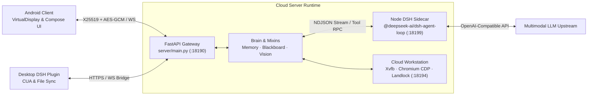

<div align="center">

# Pulse Agent

**Multi-Device Proactive AI Companion & Autonomous Execution System**
<br />
**多端协同个人智能伴侣与跨设备自主执行系统**

[-0A84FF?style=flat-square)](https://github.com/uiwcvb/pulse-agent/releases/latest)
[](#-系统架构-architecture)
[](#-核心能力-features)
[](LICENSE)

[核心特性](#-核心能力-features) · [系统架构](#-系统架构-architecture) · [快速开始](#-快速开始-quick-start) · [安全设计](#-安全与隐私设计-security) · [测试与校验](#-测试与质量保证-testing)

</div>

---

**Pulse Agent** 是一套面向日常与开发场景的多端主动式 AI 伴侣系统，贯彻 **「在看得见的地方做减法，在看不见的地方做加法」** 的产品设计哲学：
前台提供接近原生系统级的极简阅读体验，后台集成 Node DSH ReAct 推理引擎、统一 `0..1000` 归一化视觉控屏、Android 后台隔离虚拟屏（`VirtualDisplay`）、24/7 云端 Linux 工作站以及跨端异步事件黑板。

## ✨ 核心能力 (Features)

| 模块 | 核心能力 |
| :--- | :--- |
| **Apple 极简交互端**<br>*(Android / Desktop)* | • **纯享正文阅读体**：单气泡时序交错渲染工具步骤与最终回复，对话过程零跳动、零干扰徽章。<br>• **1:1 左滑线性遥测**：左滑消息气泡随手指位移线性展示工程遥测（Prefix Cache 命中率、TTFT、TPS、步数）。<br>• **分级通知与全局悬浮窗**：弱通知进系统通知栏，强提醒直接在物理主屏 `Display 0` 弹出毛玻璃决策卡。 |
| **Android 后台隔离虚拟屏**<br>*(Phone Workspace)* | • **零打扰后台执行**：操作微信、小程序或第三方 App 均在独立 `VirtualDisplay` 内完成，不抢占物理主屏焦点与桌面。<br>• **视觉 + 无障碍双通道**：同时向模型提供无障碍节点树（`@e1..@eN`）与带 `0..1000` 刻度尺的实时截图，精准覆盖自绘制页面与 Canvas 应用。<br>• **三态可挂起小窗**：支持缩放成角落迷你挂起窗、拖边吸附成侧边悬浮球与显式销毁。 |
| **Node DSH Brain Sidecar**<br>*(Agent Loop & KV Cache)* | • **官方 `@deepseek-ai/*` 内核驱动**：基于 Cordis Kernel + AgentLoop 实现稳定流式工具调用、中断保护（`cancel`）与历史回滚（`resetSession`）。<br>• **98%+ 前缀缓存友好**：静态系统前缀锁定 + 原生 `assistant(tool_calls)` / `role: tool` 回放 + 满 `100K` 分段局部压缩。<br>• **端到端图片魔数校验**：基于字节魔数（JPEG/PNG/GIF/WEBP/BMP）自动识别并修正不匹配的 `data:image/*` 头，杜绝上游多模态格式拒收。 |
| **24/7 隔离云电脑 & 黑板协同**<br>*(Cloud OS & Blackboard)* | • **Cloud Workstation**：内置 `1280×800` Xvfb + Chromium CDP + Tmux 终端守护进程，统一 `0..1000` 坐标与 DOM 快照协同。<br>• **多端花名册与黑板**：手机端、桌面端与云端助理各自拥有独立身份，通过 `blackboard`（`<50ms` `@mention` / `claim` / `review` / `steer`）异步协作。 |

---

## 🏛 系统架构 (Architecture)



更多模块职责、变量注册与接口详情请参阅 [CODEBASE_MAP.md](CODEBASE_MAP.md)。

---

## 📁 目录结构 (Project Structure)

```text
pulse-agent/
├── android/                  # Kotlin + Jetpack Compose 原生客户端、VirtualDisplay 与 Root/ADB 运行时
├── desktop/dsh-plugin/       # DSH 桌面端插件、Win32 CUA 引擎、工作区同步与双端消息渲染
├── server/
│   ├── main.py               # FastAPI 网关入口、鉴权中间件与 WebSocket 实时推流
│   ├── brain.py              # 对话编排核心与多 Mixin 组装
│   ├── core/                 # 工具路由、视觉坐标系标注、记忆检索、压缩、黑板与定时调度
│   ├── cloud_os/             # 1280x800 隔离云桌面、Chromium CDP DOM 提取与 Tmux 终端
│   ├── dsh_brain/            # Node v22 DSH Agent Loop Sidecar（含 OpenAI 兼容适配器与测试）
│   └── tests/                # Pytest 全量回归与静态安全守卫套件
├── scripts/                  # 代码地图核验、环境初始化与可配置私有主机部署脚本
├── docs/                     # 架构演进与设计方案文档
├── .env.example              # 环境变量配置模板
├── CODEBASE_MAP.md           # 100% 生产文件覆盖的代码定位图谱
└── THIRD_PARTY_NOTICES.md    # 第三方开源组件与参考许可声明
```

---

## 🚀 快速开始 (Quick Start)

### 方式一：零门槛起步（只需手机 + API Key + 空白 VPS）
1. 安装 Android 客户端后选择 **「只有 API Key · AI 帮我搭」**，填入任意大模型 Key 即可直接和本地引导 AI 对话。
2. 点击 **「填 VPS SSH 一键搭建」**，在安全本地表单中填入一台空白 Ubuntu/Debian VPS 的 SSH（凭据仅手机本地直连 SSH，绝不发送给第三方大模型），App 会自动完成：
   - 部署并启动中枢大脑网关（默认兼容开源 `BRAIN_ENGINE=legacy`）与 Nginx WebSocket 代理；
   - 自动部署 **24/7 云端桌面**（Xvfb + Openbox + Chromium + Tmux）并绑定到中枢；
   - 自动同步你的 API Key 并完成手机配对。
3. **手机免 Root 控屏**：打开系统「无线调试」启动 **Shizuku**（开启后切 5G 流量也不掉线），回 App 点「一键授权 Shizuku」（或用内置无线 ADB 6 位码配对）。
4. **电脑端自动接入**：复制手机端生成的电脑接入指令发给电脑上的 AI（Claude Code / Codex / Antigravity / Cursor），或直接读取 [`.agents/skills/pulse-pc-bootstrap/SKILL.md`](.agents/skills/pulse-pc-bootstrap/SKILL.md) / 运行：
   ```bash
   # DSH 桌面端插件：
   node desktop/dsh-plugin/setup.mjs --pair-code "DSCLAW1:<SERVER_URL>|<TOKEN>"
   # 跨平台轻量代理 (Windows / macOS / Linux)：
   python desktop/desktop_agent.py --pair-code "DSCLAW1:<SERVER_URL>|<TOKEN>" --save --check
   ```

### 方式二：让你的 AI Agent 按 Skill 一键全端启动（推荐开发者）
让你的编码 Agent 直接读取：
- 全端部署总纲：[`.agents/skills/pulse-quickstart/SKILL.md`](.agents/skills/pulse-quickstart/SKILL.md)
- 电脑端自动接入：[`.agents/skills/pulse-pc-bootstrap/SKILL.md`](.agents/skills/pulse-pc-bootstrap/SKILL.md)

### 方式三：手工环境准备与启动

#### 1. 环境准备
- **Python**: `3.11+`
- **Node.js**: `20+` / `22+`（用于 `server/dsh_brain`）
- **Android Build**: JDK `17` + Gradle `8.11`（可选，仅构建客户端 APK 时需要）

### 2. 配置环境变量
```bash
cp .env.example .env
# 编辑 .env，填入你的 OPENAI_BASE_URL、DEEPSEEK_API_KEY 与强随机 AGENT_TOKEN
```

### 3. 启动服务端与 Node DSH Sidecar

**启动 Node DSH Sidecar (`:18199`)**：
```bash
cd server/dsh_brain
npm install
npm start
```

**启动 Python FastAPI 网关 (`:18190`)**：
```bash
cd server
python -m venv .venv
# Linux / macOS: source .venv/bin/activate
# Windows PowerShell: .\.venv\Scripts\Activate.ps1
pip install -r requirements.txt
uvicorn main:app --host 127.0.0.1 --port 18190
```

> 生产环境建议配合 Nginx / Caddy 等反向代理提供 HTTPS，并在 `.env` 中设置 `DS_CLAW_PUBLIC_URL` 与 `PUBLIC_BLOCKED_HOSTS`（你的公网域名或出口 IP，防止云电脑浏览器 SSRF 探测宿主机）。

### 4. 构建 Android 客户端（可选）
```bash
cd android
# 通过环境变量传入签名密码或使用 debug 构建
./gradlew testDebugUnitTest assembleDebug
```
安装后在引导页填入你自己的服务端地址（例如 `https://your-domain.example.com/proactive-agent`）、设备 Token 与上游模型 Key 即可配对使用。

### 5. 接入桌面端插件（可选）
```bash
export DS_CLAW_SERVER_URL="https://your-domain.example.com/proactive-agent"
export DS_CLAW_TOKEN="your-device-token"
node desktop/dsh-plugin/setup.mjs
```

---

## 🔒 安全与隐私设计 (Security)

- **零硬编码凭证与服务器地址**：仓库内严禁硬编码公网服务器 IP、密钥或个人路径（由 `server/tests/test_no_toxic_limits_guard.py` 自动化守卫）；所有敏感信息统一通过环境变量、`.env` 或被 `.gitignore` 忽略的 `private/` 目录注入。
- **端到端加密传输**：Android 与网关之间支持 X25519 + AES-GCM 加密信封通道（`SecureTransport.java` / `server/transport`）。
- **云工作站沙箱与 SSRF 防护**：支持 Linux Landlock 文件系统限制，代理与浏览器导航自动拦截回环、内网、云元数据及宿主机自身公网地址（`server/computer_security.py`）。
- **记忆金库敏感信息脱敏**：`Vault` 写入前自动识别并遮蔽 API Key、私钥块与敏感证件/卡号，只读对外分享档案支持按场景与 Token 作用域隔离。

---

## 🧪 测试与质量保证 (Testing)

在提交修改前，建议运行以下完整验证：

```bash
# 1. Python 服务端全量回归与安全守卫测试
python -m pytest server/tests -q

# 2. Node DSH Sidecar 单元测试
npm --prefix server/dsh_brain test

# 3. CODEBASE_MAP 100% 文件覆盖校验
python scripts/verify_codebase_map.py

# 4. 桌面插件语法校验 (Node 20+)
node --check desktop/dsh-plugin/setup.mjs
```

---

## 📄 开源协议与致谢 (License & Acknowledgements)

- 本项目源码采用 [MIT License](LICENSE) 开源发布。
- 第三方依赖许可与 UI / 技术参考声明详见 [THIRD_PARTY_NOTICES.md](THIRD_PARTY_NOTICES.md)。
